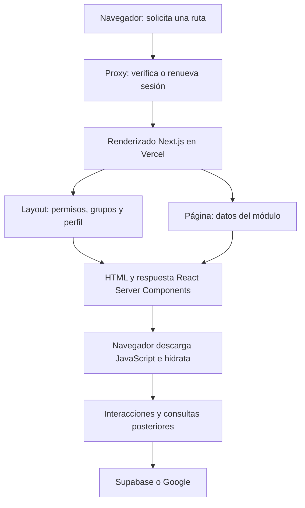

# Evaluación de arquitectura y ejecución web

26 de octubre de 2026. Base publicada en main: 2de7f6c. Segunda iteración: rama codex/web-loading-flow.

## Conclusión

La plataforma usa Next.js App Router, React Server Components, renderizado de servidor, navegación cliente y Suspense: una base moderna. No hay evidencia para justificar una reescritura de framework como primera medida.

La debilidad está en el reparto de responsabilidades: cada módulo ha desarrollado su propio sistema de consultas, estados de carga, actualización y caché. Algunos esperan datos antes de responder desde el servidor; otros devuelven una interfaz vacía y esperan a descargar JavaScript antes de consultar. El programa mezcla ambos modelos sin un contrato de lectura uniforme.

La primera entrega mejoró seguridad, región, deduplicación y separación de herramientas. Eso no demuestra una reducción perceptible de carga. Esta segunda revisión sigue el trabajo real de las pantallas y corrige duplicaciones y esperas concretas.

## Qué programa estamos optimizando

La web es un sistema de colaboración de laboratorio: grupos y permisos, cuaderno de trabajo, muestras y su genealogía, caracterizaciones, reportes, tareas, eventos, documentos e integración Google. Su recorrido habitual debe priorizar metadatos y acciones pequeñas.

El análisis científico pesado y el vault local pertenecen al entorno de escritorio. No deberían convertirse en dependencias necesarias para consultar tareas, leer una nota o explorar un listado web.

## Cómo se carga actualmente

Layout y página pueden ejecutarse en paralelo; no se deben sumar como etapas siempre consecutivas. El helper React.cache reutiliza usuario y cliente dentro del renderizado de una petición, pero no elimina las comprobaciones de otra petición del proxy o de una redirección.

Al entrar por /, hay una consulta de grupos y una redirección al dashboard. Una navegación dentro del mismo grupo puede conservar el layout y aprovechar la caché del router; no equivale a recargar todo el sitio. staleTimes ayuda a volver a rutas visitadas, pero no es una caché uniforme de resultados de Google, búsquedas o listados.

Los componentes cliente también pueden recibir HTML inicial del servidor. El problema relevante no es la etiqueta use client por sí sola, sino que la consulta empiece únicamente dentro de useEffect, después de descargar JavaScript y activar la pantalla.

## Mapa por módulo

| Módulo | Función | Carga observada en la base publicada | Reorganización adecuada |
|---|---|---|---|
| Dashboard | Resumen de trabajo | Widgets servidor bajo Suspense | Conservar streaming; medir cada consulta |
| Samples | Genealogía y registros | Cuadernos primero; luego todas las muestras con caracterizaciones completas; árbol y búsqueda cliente | Resumen de lista, detalle independiente, estructura ligera de parentesco |
| Drive Reports | Documentos y reportes compartidos | Listado completo con secciones, tareas vinculadas y asignados | Proyección de lista y detalle al expandir |
| Weekly Reports | Informes semanales | Lista generada en servidor | Mantener servidor; paginar si el volumen lo requiere |
| Tasks | Kanban y lista | Todas las tareas; carga estática de tablero, lista y formulario; efecto de reparación con escrituras | Mutaciones explícitas; cargar vista y formulario cuando se necesiten |
| Calendar | Eventos y tareas | Tareas servidor; eventos después de montar FullCalendar mediante Server Action; inicialización Google amplia | Semilla inicial y consulta por rango; Google Calendar aislado |
| Logbook | Cronología, galería y cuaderno | Cronología, tareas y fechas consultadas después de montar; documentos consultados al abrir notebook | Semilla del servidor, historial por cursor, contenido de documento bajo demanda |
| Drive | Explorador de archivos | Ajustes servidor; scripts Google; discovery de varios servicios; listado duplicado; búsqueda recursiva repetida | Una ruta de lectura, caché acotada, árbol reutilizable, paginación y respuestas con versión |
| Knowledge | Biblioteca de recursos | Todos los elementos; filtro y orden cliente; refresh tras cambiar una estrella | Lista ligera, detalle separado y actualización puntual |
| Settings | Miembros e integraciones | Grupo servidor; después miembros y formularios | Paneles con cargas independientes; no precargar integraciones ajenas al panel |
| Nexus AI | Preguntas y herramientas | Sesiones después de montar; historial completo al abrir; respuesta completa al terminar hasta cinco rondas de herramientas | Historial acotado, streaming y herramientas con alcance explícito |

## Cambios de estructura de la segunda iteración

### 1. Drive tiene una ruta de lectura y un servicio de datos propio

Antes había dos efectos que podían pedir el listado inicial. Cada búsqueda volvía a descubrir subcarpetas, y las respuestas de solicitudes anteriores podían reemplazar las de una búsqueda nueva. Los listados tampoco solicitaban ni recorrían nextPageToken.

Se introduce src/lib/google/drive-data.ts:

- Peticiones idénticas simultáneas comparten el trabajo.
- Páginas recientes se reutilizan durante 30 segundos; el índice de carpetas, durante 60.
- La caché pertenece a una instancia del grupo/configuración montada, sin compartir datos globalmente entre usuarios.
- El usuario puede cargar las siguientes páginas de una carpeta.
- La búsqueda recorre las páginas necesarias y reutiliza el árbol entre términos.
- Hasta cuatro lotes independientes se procesan en paralelo.
- La versión de solicitud impide que resultados antiguos sustituyan la búsqueda actual.
- El refresco y las mutaciones invalidan lo reutilizable; los fallos no se guardan como éxitos.
- El historial de navegación de carpetas se actualiza sin pedir otra respuesta de página a Next.js para un estado que maneja el navegador.

No se hace una búsqueda global en todo el Drive personal para acelerar un resultado: se conserva el alcance de la carpeta raíz configurada. El índice puede quedarse desactualizado brevemente ante cambios externos; actualizar lo invalida.

### 2. Google se inicializa por servicio

La inicialización anterior esperaba Drive, Docs, Slides y Calendar incluso al entrar al explorador. Ahora los consumidores de archivos solicitan Drive y el calendario solicita Calendar. La inicialización se coordina para evitar que dos componentes repitan el trabajo a la vez, permite reintentar un fallo y distingue cambios de configuración OAuth.

Los generadores existentes conservan su comportamiento compatible mientras se migran a capacidades explícitas. No se cambian cuentas, ámbitos OAuth ni credenciales.

### 3. Logbook recibe su primera página desde el servidor

La primera página de hasta 50 entradas y los estados de tareas se consultan en paralelo con los ajustes del grupo y se entregan a LogbookView. Así se elimina la espera obligatoria JavaScript → montaje → primera consulta para ese contenido.

El navegador mantiene paginación y tiempo real. Si falla la semilla del servidor, conserva el intento cliente. Una respuesta vacía o fallida termina el estado de carga: no deja el contenido invisible indefinidamente. Se comprueba membresía activa antes de preparar la semilla.

Esto puede trasladar parte del tiempo al renderizado del servidor a cambio de entregar contenido inicial útil. Hace falta medir TTFB y contenido visible juntos; optimizar solo uno puede producir conclusiones engañosas.

### 4. Abrir Tasks deja de escribir datos

El efecto anterior buscaba estados no incluidos en las columnas y llamaba automáticamente a moveTasksToStatusAction. Podía repetir escrituras y revalidaciones, incluso si una consulta de columnas fallaba y se usaban columnas de reserva.

Se elimina esa reparación al montar. El tablero ya muestra tareas de estados desconocidos en una columna de reserva sin necesidad de escribir. Renombrar/eliminar columnas sigue siendo una acción explícita del usuario.

### 5. Calendar diferencia datos recibidos de solicitudes pendientes

Antes se marcaba el rango como cargado antes de que terminara la consulta. Un fallo podía impedir reintentar el mismo rango. Ahora se diferencia el rango pendiente del último recibido, se permite reintentar y se descartan respuestas superadas por otra navegación.

## Qué conviene modernizar después

### Contratos de lectura por pantalla

Definir estructuras pequeñas como SampleListItem, SampleDetail, ReportListItem y ReportDetail. La lista no necesita todas las caracterizaciones ni todas las secciones de cada reporte. Evitar reutilizar una única consulta completa para lista, buscador, selector y editor.

En Samples hay una duplicación verificable: se envían las caracterizaciones completas al listado y el detalle vuelve a consultarlas. La solución es separar resumen/detalle y reutilizar el resultado donde corresponda, con una política de actualización clara. La paginación debe preservar padres, búsqueda global y selección; poner limit(50) sin rediseñar eso rompería funciones.

### Un criterio de consultas para toda la web

Las consultas iniciales deben resolverse cerca del contenido de servidor. Las lecturas interactivas pueden usar Supabase con RLS o endpoints GET específicos, con caché de cliente y semillas iniciales. Server Actions deben concentrarse en mutaciones.

Next.js advierte que las Server Actions llamadas desde el cliente se encolan: utilizarlas como canal general de lectura puede introducir ejecución secuencial. Invocar funciones directamente dentro de un Server Component es otro caso; el Promise.all del servidor no queda automáticamente serializado por esa regla. [Next.js: Backend for Frontend](https://nextjs.org/docs/app/guides/backend-for-frontend).

TanStack Query ya está instalado, pero no se encontró un QueryClientProvider ni uso de useQuery en src. Puede servir para unificar consultas de rangos, búsquedas, detalle y actualizaciones puntuales. Las claves deben incluir usuario, grupo, recurso y filtros; la caché debe limpiarse al cambiar de cuenta. Una semilla del servidor evita volver a consultar inmediatamente al montar si la política de frescura está bien definida. [TanStack: SSR e hidratación](https://tanstack.com/query/latest/docs/framework/react/guides/ssr).

### Autenticación y rutas públicas

El proxy usa getUser incluso antes de responder rutas públicas. También quedan redirecciones que crean peticiones nuevas. Evaluar getClaims para verificar identidad con claves asimétricas y conservar getUser donde se necesite estado fresco del usuario. No se ha confirmado en esta revisión el tipo de firma configurado en este proyecto: no se promete eliminar el viaje de red sin comprobarlo. Con clave simétrica la validación puede seguir siendo remota. [Supabase SSR](https://supabase.com/docs/guides/auth/server-side/creating-a-client).

### Menos refresh de página para cambios pequeños

Knowledge llama router.refresh después de cambiar una estrella aunque la acción ya revalida datos. Conviene actualizar el elemento visible y revalidar su consulta, con recuperación si falla. Lo mismo se debe evaluar por operación, conservando sincronización entre usuarios.

### Componentes por responsabilidad

Separar consultas, transformaciones de dominio, control de interacción y presentación. Las vistas grandes mezclan formularios, red, archivos, filtros y persistencia; dividirlas debe producir límites de carga y actualización útiles. Dividir archivos sin cambiar esas responsabilidades no hace más rápida la aplicación.

## ¿Hay tecnologías nuevas que convenga adoptar?

| Mecanismo | Valor para este proyecto | Decisión |
|---|---|---|
| RSC y streaming con Suspense | Contenido inicial y widgets independientes | Mantener y ampliar por pantalla |
| Caché de consultas con hidratación | Volver a módulos y rangos sin repetir todas las lecturas | Adoptar gradualmente donde aporte reutilización |
| Cache Components de Next.js | Separar estructura reutilizable de datos por petición | Prototipo aislado; requiere límites correctos para cookies y permisos |
| SSE/streaming de respuesta de IA | Mostrar avance y texto de Nexus AI antes de que termine todo | Apropiado para chat; no sustituye la carga CRUD |
| Realtime/WebSockets | Cambios de colaboración | Mantener para datos activos; aplicar diferencias sin recargar todo |
| Web Workers | Cálculo pesado fuera del hilo de interfaz | Reservar para datos científicos grandes, después de medir |
| GraphQL o cambio de HTTP | No arreglan por sí solos duplicaciones ni exceso de datos | No migrar por expectativa de velocidad |
| Otro framework | Coste elevado sin cuello de botella demostrado en Next.js | No reescribir ahora |

Cache Components y la precarga moderna deben evaluarse con el modelo de navegación real. No se puede añadir caché compartida a permisos o datos privados sin revisar su alcance. Los enlaces dinámicos también pueden precargar parcialmente la estructura con loading.tsx; no se debe asumir que todo el contenido de todos los enlaces ya se descargó. [Caché Next.js](https://nextjs.org/docs/app/getting-started/caching), [navegación Next.js](https://nextjs.org/docs/app/getting-started/linking-and-navigating).

## Google MCP

Google ofrece servidores MCP remotos por producto, incluidos Drive, Docs, Sheets, Slides y Calendar. Su documentación los mantiene en Developer Preview. Sirven para que agentes descubran y ejecuten herramientas; requieren configuración y OAuth. [Google Workspace MCP](https://developers.google.com/workspace/guides/configure-mcp-servers).

Para Nexus AI, un MCP oficial puede reducir adaptadores propios para buscar documentos y consultar eventos. Para las pantallas de archivos y calendario, las API directas siguen proporcionando un camino explícito y controlable de paginación, filtros y caché. Introducir un modelo para decidir cómo cargar cada lista añade trabajo y variabilidad.

Propuesta: herramientas MCP limitadas para la capa de agente, servicios de lectura explícitos para la interfaz. Un piloto debe comprobar disponibilidad de las operaciones necesarias, permisos por usuario y grupo, cuotas y errores. No se configuró ni activó un nuevo MCP durante esta entrega.

## Componente que sí tiene señales de obsolescencia

El proyecto usa @google/generative-ai. Google clasifica su SDK JavaScript anterior como legado sin mantenimiento activo y recomienda @google/genai. Además, el código fuerza nombres que contienen 2.5 a gemini-1.5-flash. Eso es una regla rígida del programa, no una comprobación válida de disponibilidad de modelos.

Modernizar esta parte requiere migrar el SDK, verificar modelos disponibles para la cuenta y revisar el bucle de herramientas y streaming. No se debe cambiar el nombre del modelo a otro por intuición. Esto afecta al asistente y generación, no explica por sí solo una lista de muestras lenta. [Bibliotecas oficiales de Gemini](https://ai.google.dev/gemini-api/docs/libraries).

## Evidencia y límites

- Producción main 2de7f6c: deployment dpl_FpFwJczXU4HQAKcQBTCxz5qQ3wxC, READY, dub1. /login respondió 200 con el contenido esperado.
- La comprobación de bundles de la primera entrega mide archivos iniciales del componente principal: Samples 99.265 bytes gzip calculado; Calendar 175.460; Drive Reports 142.384; Logbook 105.389. No son el total de red de la página ni tiempos de navegación. Los chunks compartidos se reutilizan y no se suman entre módulos.
- Benchmark reproducible scripts/benchmark-sample-filter.mjs: usa el algoritmo actual del árbol/filtro y datos sintéticos. Con 121 filas se observaron aproximadamente 0,5–0,8 ms; con 10.000 filas, aproximadamente 45–56 ms por cálculo en Node. Excluye DOM, componentes, red y equipo real del usuario. No demuestra un tiempo de navegador ni una mejora antes/después.
- Las nuevas pruebas de Drive verifican deduplicación de dos solicitudes simultáneas, páginas siguientes, reutilización del árbol, expiración, invalidación, aislamiento de fuentes y fallos reintentables.
- Las pruebas Google verifican que Drive no espere documentos de Calendar/Docs/Slides, que la inicialización concurrente no se repita y que un fallo permita reintentar.
- Sigue pendiente una traza autenticada de navegador con TTFB, LCP/INP, peticiones, tamaño de datos y duración por etapa. No se calcularon porcentajes de mejora a partir de cambios de código.

## Orden de trabajo recomendado

1. Publicar las correcciones acotadas de flujo y comprobar que no haya regresiones.
2. Medir login → dashboard y apertura de Samples, Drive y Logbook con una sesión real; separar primera visita, revisita y actualización.
3. Separar DTO de lista/detalle en Samples y Reports y migrar sus lecturas interactivas a una política coherente de caché.
4. Reducir inicialización/autenticación remota cuando el tipo de firma y los permisos lo permitan.
5. Modernizar Nexus AI: SDK mantenido, historial acotado, streaming y piloto MCP.
6. Evaluar Cache Components y recorte interno de bibliotecas con medición por ruta, manteniendo los puntos de recuperación.
